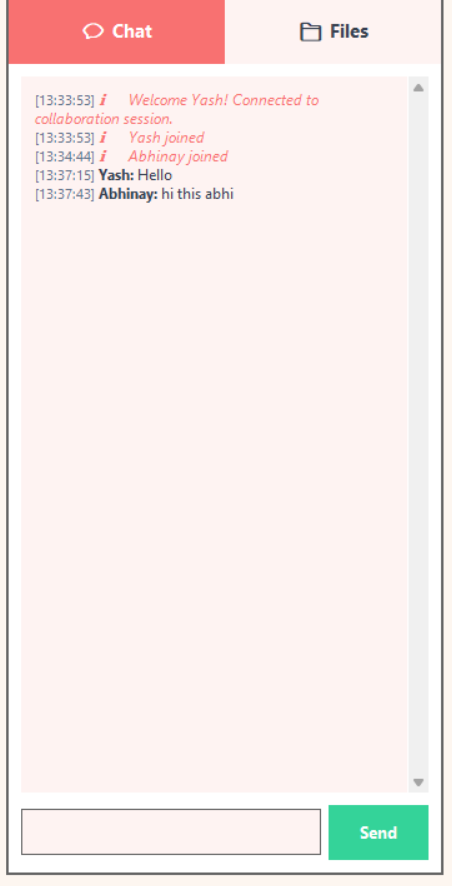

# LAN-Based Multi-User Peer-to-Peer (P2P) Communication & Collaboration System

[](https://www.python.org/)
[]()
[]()
[]()

**Course:** Computer Networks  
**System Architecture:** Fully Decentralized Peer-to-Peer (P2P) Full-Mesh Overlay Network  
**Platform:** Cross-Platform (Windows, macOS, Linux)  
**Repository:** [vandearvans/p2p-vid](https://github.com/vandearvans/p2p-vid)

---

## 📸 Screenshots

| Real-Time Video & Screen Presentation |
|:---:|
|  |

| Direct & Group Text Chat | Decentralized P2P File Transfer |
|:---:|:---:|
|  |  |

---

## 📌 Project Overview & Motivation

Modern collaboration platforms (Zoom, Microsoft Teams, Google Meet) rely heavily on centralized cloud or on-premise relay servers. While convenient, centralized architectures suffer from critical shortcomings:
1. **Single Point of Failure (SPOF):** If the central server crashes or loses connectivity, the entire session terminates for all users.
2. **Bandwidth Bottleneck:** High-bandwidth streams (HD video, screen sharing, large file transfers) congest the server's network link.
3. **Increased Latency:** Media packets must travel from Peer A → Server → Peer B (2 hops), doubling network delay.

This project delivers a **fully autonomous, standalone Peer-to-Peer (P2P) collaboration system** running entirely within a Local Area Network (LAN). **There is no central server.** Every node acts as a **Servent** (both Client and Server), creating a self-organizing, self-healing full-mesh overlay network.

### 🌟 Core Capabilities
1. **P2P Video Conferencing:** Direct UDP datagram streaming between peers with JPEG compression and dynamic multi-tile UI layout.
2. **P2P Audio Conferencing:** Low-latency 16-bit mono PCM microphone capture and playback over direct UDP channels with mute controls.
3. **P2P Desktop Screen Sharing:** High-resolution screen capture streamed with atomic binary framing over direct TCP links, managed by distributed presenter floor control.
4. **Group & Private Text Chat:** Instant broadcast messaging to the mesh or 1-on-1 private messaging over reliable TCP sockets.
5. **Direct P2P File Sharing:** Decentralized file announcements and direct point-to-point chunked binary file transfer with end-to-end **SHA-256 cryptographic checksum verification**.
6. **Zero-Configuration LAN Auto-Discovery:** Automatic discovery of peers via UDP Broadcast beaconing (Port `5550`).
7. **Adaptive Dynamic Theming:** Beautiful Tkinter interface featuring 5 color palettes (Olive Minimal, Morning Glow, Daytime Crisp, Sunset Amber, Midnight Cyber) with time-of-day auto-switching and manual controls.

---

## 🌐 Network Architecture & Protocol Comparison

### Client-Server vs. Pure Peer-to-Peer

| Parameter | Centralized Client-Server | Our Pure P2P Full Mesh |
|---|---|---|
| **Central Server Required?** | **Yes** (server.py must run 24/7) | **No** (any peer starts first) |
| **Failure Tolerance** | Server crash drops all participants | **Self-healing:** if any peer drops, mesh auto-heals |
| **Media Latency** | 2 network hops (Peer $\to$ Server $\to$ Peer) | **1 direct hop** (Peer $\to$ Peer) |
| **File Storage** | Uploaded to server disk | Kept locally on offering peer; streamed direct P2P |
| **Discovery** | Hardcoded server IP | **UDP Broadcast beaconing** + Peer Exchange (PEX) |
| **Scalability Limit** | Central server link saturation | Distributed across all participating peers |

---

## 📡 Protocol Stack & Port Allocation

```
+--------------------------------------------------------------------------+
|                     APPLICATION & COLLABORATION LAYER                    |
|  [Video Streams]  [Audio Voice]  [Screen Share]  [Group/Priv Chat]  [Files] |
+------------------------+-------------------+-----------------------------+
|    MEDIA TRANSPORT     | DISCOVERY BEACON  |   RELIABLE DATA & CONTROL   |
|       (UDP Mesh)       |  (UDP Broadcast)  |          (TCP Mesh)         |
|       Port: 5556+      |     Port: 5550    |          Port: 5555+        |
+------------------------+-------------------+-----------------------------+
|                               INTERNET LAYER                             |
|                              IPv4 / LAN Subnet                           |
+--------------------------------------------------------------------------+
```

### 1. TCP Framing Protocol (Port 5555+)
TCP is a byte-stream protocol with no intrinsic message boundaries. To prevent packet coalescing and message fragmentation, our system implements an **Atomic 7-Byte Binary Header**:

$$\underbrace{\texttt{0x50 0x32}}_{\text{Magic: 'P2' (2B)}} \quad \underbrace{\texttt{MsgType}}_{\text{1 Byte}} \quad \underbrace{\texttt{Payload Length}}_{\text{4 Bytes (Big-Endian uint32)}} \quad \underbrace{\texttt{[Binary / JSON Payload]}}_{\text{N Bytes}}$$

* **`0x01` (Control & Signaling):** Handshakes, Peer Exchange (PEX), Chat, Heartbeats, Floor Tokens.
* **`0x02` (Screen Presentation):** High-speed JPEG screen frames.
* **`0x03` (P2P File Chunks):** Chunk metadata header (`transfer_id`, `chunk_idx`, `is_last`) followed by raw 64 KB binary file chunks.

### 2. UDP Media Datagrams (Port 5556+)
Real-time webcam video and microphone voice packets require minimal latency over delivery guarantees:
* **Video Format:** `VID:<sender_peer_id>:<username>:<jpeg_bytes>`
* **Audio Format:** `AUD:<sender_peer_id>:<username>:<pcm_bytes>`

### 3. LAN Auto-Discovery & Peer Exchange (PEX) (Port 5550)
1. **Periodic UDP Beacons:** Each node broadcasts periodic JSON discovery beacons to `255.255.255.255:5550`.
2. **Zero-Configuration Handshake:** When Peer B hears Peer A's beacon, Peer B establishes a direct TCP socket connection to Peer A.
3. **Peer Exchange (PEX) Gossip:** When Peer C connects to Peer B, Peer B sends its list of known peers to Peer C. Peer C immediately initiates direct connections to Peer A. Within seconds, a **Full Mesh Overlay Topology** is formed.

---

## 📁 Repository Structure

```
P2P/
├── run.bat                   # Master one-click launcher (checks environment & runs app)
├── run_demo_mesh.bat         # Instant 2-peer live mesh launcher (Alice & Bob)
├── run_tests.bat             # One-click automated test suite launcher
├── peer.py                   # Main GUI application (Tkinter + Video/Audio/Screen/Files)
├── cli_peer.py               # Headless CLI peer for terminal/scripted benchmarking
├── config.py                 # Network ports, buffer sizes, timeouts, media settings
├── requirements.txt          # Python library dependencies
├── test_suite_p2p.py         # Complete 8-stage automated test suite
├── README.md                 # Project documentation
├── Screenshots/              # UI screenshots
│   ├── Chat.png
│   ├── File transfer.png
│   └── Video + Screen sharing.png
├── core/                     # Networking & Media Subsystems
│   ├── __init__.py
│   ├── protocol.py           # 7-byte binary TCP framing & UDP parser
│   ├── node.py               # P2P Node (Servent) engine & mesh manager
│   ├── discovery.py          # Zero-config UDP LAN broadcast beacon
│   ├── file_transfer.py      # Direct chunked P2P file transfers with SHA-256
│   ├── media.py              # Real-time Audio (PCM) & Video (OpenCV) engines
│   └── screen_share.py       # Desktop capture engine (MSS / PIL fallback)
├── ui/                       # Graphical User Interface
│   ├── __init__.py
│   ├── theme.py              # Dynamic theme manager (5 adaptive palettes)
│   └── main_window.py        # Modern Tkinter interface & thread-safe dispatcher
└── shared_files/             # Default shared & downloaded files directory
```

---

## ⚙️ Prerequisites & Installation

### 1. Requirements
* Python 3.8 to 3.14
* Windows, Linux, or macOS

### 2. Installation
Open a terminal in the project directory and run:

```bash
# 1. Create a virtual environment (optional but recommended)
python -m venv venv

# Activate on Windows:
venv\Scripts\activate
# Activate on Linux/macOS:
source venv/bin/activate

# 2. Install required dependencies
pip install -r requirements.txt
```

---

## 🚀 How to Run

### One-Click Windows Batch Launchers (Recommended)

Three pre-configured `.bat` launchers are included in the root directory:

* **`run.bat` (Master Launcher):** Checks Python & dependencies, then gives an interactive menu to launch standard GUI, 2-peer demo, 3-peer full mesh, or the test suite.
* **`run_demo_mesh.bat` (Instant 2-Peer Demo):** Double-click to instantly launch Alice and Bob in separate windows already connected to each other on localhost.
* **`run_tests.bat` (Test Runner):** Double-click to run all 8 automated test cases.

---

### Scenario A: Testing with Multiple Peers on the Same Computer (Localhost)
You can easily simulate multiple peers on a single PC by running instances with different ports:

**Terminal 1 (Alice):**
```bash
python peer.py --username Alice --tcp 5555 --udp 5556
```

**Terminal 2 (Bob):**
```bash
python peer.py --username Bob --tcp 5557 --udp 5558 --connect 127.0.0.1:5555
```

**Terminal 3 (Charlie):**
```bash
python peer.py --username Charlie --tcp 5559 --udp 5560 --connect 127.0.0.1:5557
```
*(Notice: Charlie connects only to Bob, but via Peer Exchange (PEX), Charlie automatically connects to Alice as well!)*

---

### Scenario B: Running on Different Computers Across a Local Area Network (LAN)
1. Ensure all laptops/PCs are connected to the same Wi-Fi router or Ethernet switch.
2. Simply launch the application on each PC:
   ```bash
   python peer.py
   ```
3. Enter your desired username and click **🚀 START / JOIN P2P MESH**.
4. The built-in **LAN Auto-Discovery (UDP 5550)** will automatically detect peers on the network and link them into the mesh!
   *(You can also use the "Connect to Peer" bar to manually connect using the other computer's LAN IP address).*

---

### Scenario C: Running in Headless / Terminal Mode (CLI)
For headless devices or automated demonstrations without GUI:
```bash
python cli_peer.py --username Dave --tcp 5561 --udp 5562 --connect 127.0.0.1:5555
```
Supports CLI commands: `/chat <msg>`, `/peers`, `/stats`, `/connect <ip:port>`, `/exit`.

---

## 🎮 Interface Features & Controls

* **📹 Video:** Toggles your webcam stream. Captures local frames, compresses to JPEG, and sends UDP packets directly to all mesh peers. Includes a virtual camera fallback when no physical webcam is detected.
* **🎤 Audio:** Toggles your microphone. Captures raw 16-bit PCM audio and streams low-latency UDP datagrams to peer speakers.
* **🖥️ Share:** Requests distributed screen presenter floor control. If granted, streams your desktop live at 10–15 FPS with atomic TCP framing.
* **💬 Chat Tab:** Send messages to all mesh peers simultaneously, or send targeted private messages.
* **📁 Files Tab:**
  * **Share Local File:** Choose any file up to 100 MB to offer to the mesh. The file remains on your disk.
  * **Download File:** Double-click any listed file from another peer to choose a destination and stream it directly over TCP with real-time progress and SHA-256 verification.
* **📊 Stats Tab:** View live network metrics including active direct mesh links, packets sent/received, bandwidth, and uptime.
* **🎨 Theme Dropdown:** Toggle between Midnight Cyber, Daytime Crisp, Sunset Amber, Morning Glow, and Olive Minimalist color themes.

---

## 🧪 Automated Test Suite

The system includes a comprehensive automated test suite testing all networking layers, socket communications, and fault tolerances without needing manual GUI interaction.

Run the test suite with:
```bash
python test_suite_p2p.py
```

### Verified Test Cases:
* `test_01_protocol_framing_and_resync`: Validates 7-byte binary header parsing, stream desynchronization recovery, and mixed frame handling.
* `test_02_two_peer_handshake_and_chat`: Tests direct peer TCP handshake, broadcast chat, and private messaging.
* `test_03_three_peer_pex_mesh_formation`: Tests 3-node full mesh formation via Peer Exchange (PEX) gossip.
* `test_04_direct_file_transfer_and_checksum`: Validates chunked binary transfer and bit-for-bit SHA-256 cryptographic match.
* `test_05_udp_media_streaming`: Validates direct UDP datagram delivery for video and audio frames.
* `test_06_screen_sharing_floor_control`: Tests presenter token acquisition and collision prevention.
* `test_07_mesh_self_healing_on_disconnect`: Verifies remaining peers detect abrupt disconnection and maintain mesh communication.
* `test_08_lan_auto_discovery_beacon`: Tests zero-configuration UDP broadcast discovery.

---

## 📄 License & Academic Integrity
Developed as a Computer Networks Course Project. Built using standard Python networking libraries (`socket`, `struct`, `threading`), OpenCV (`cv2`), Pillow, MSS, and Sounddevice.
